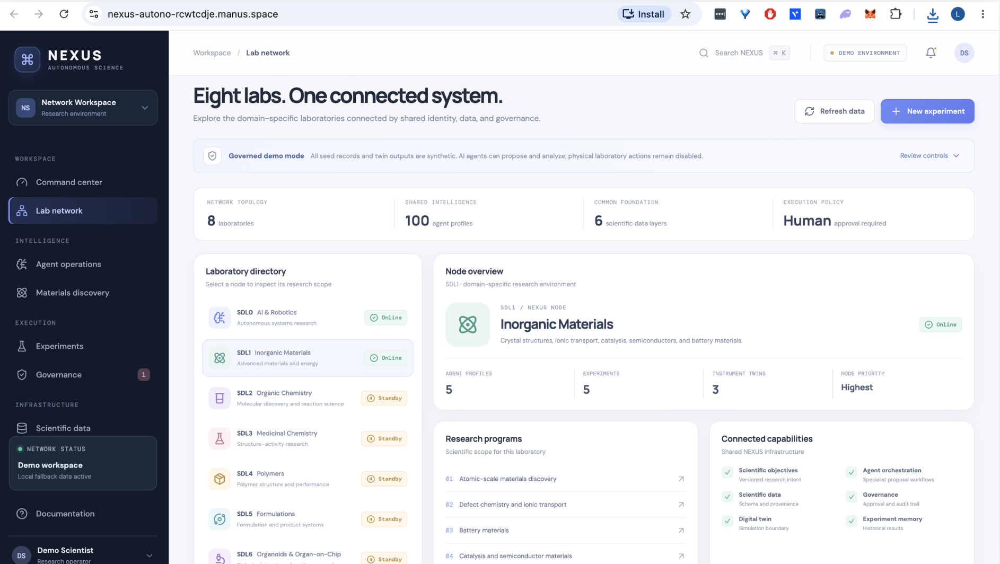
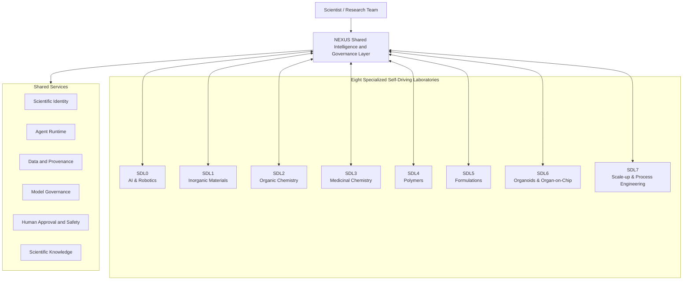
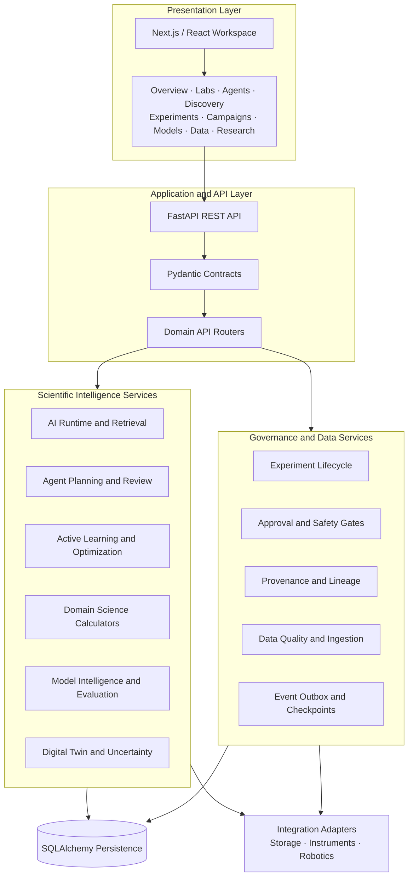
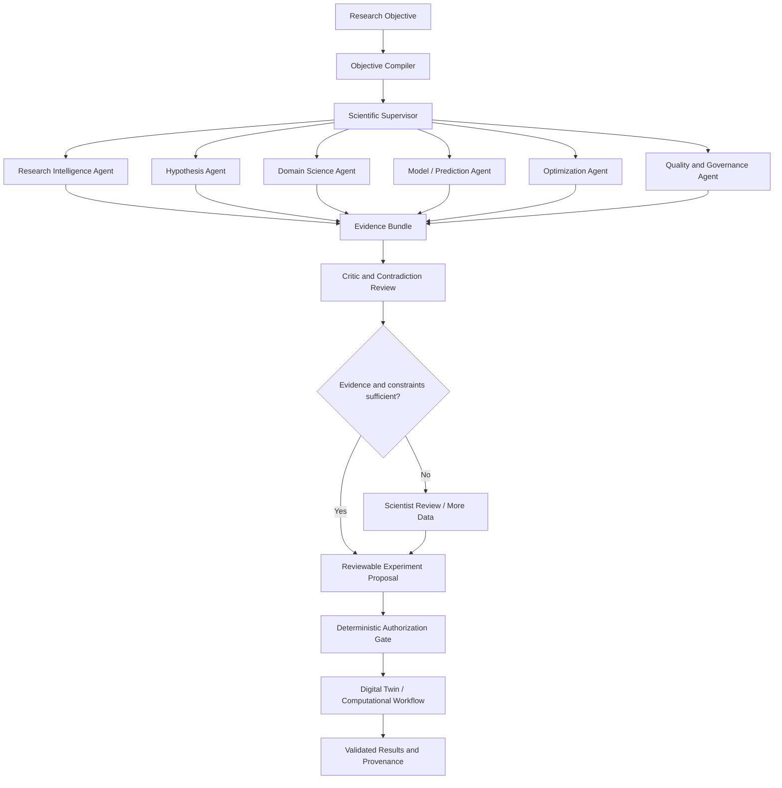
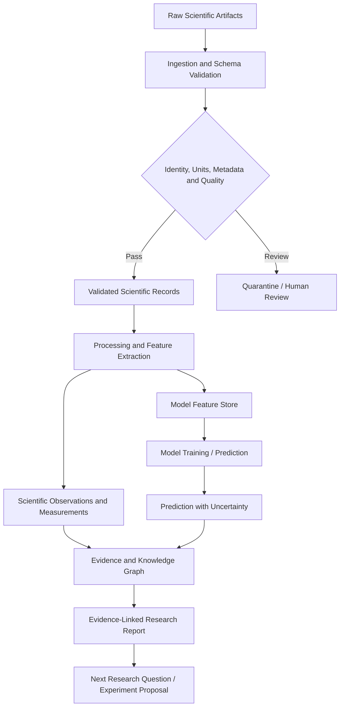
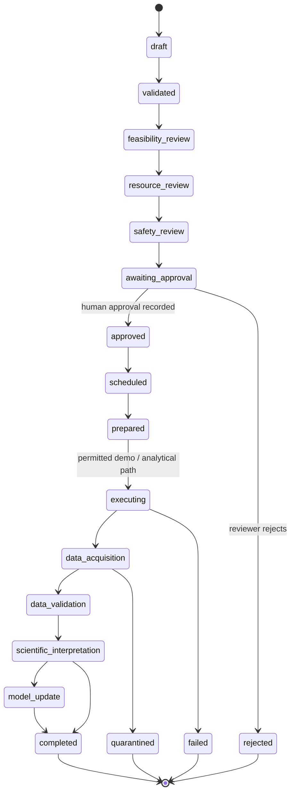
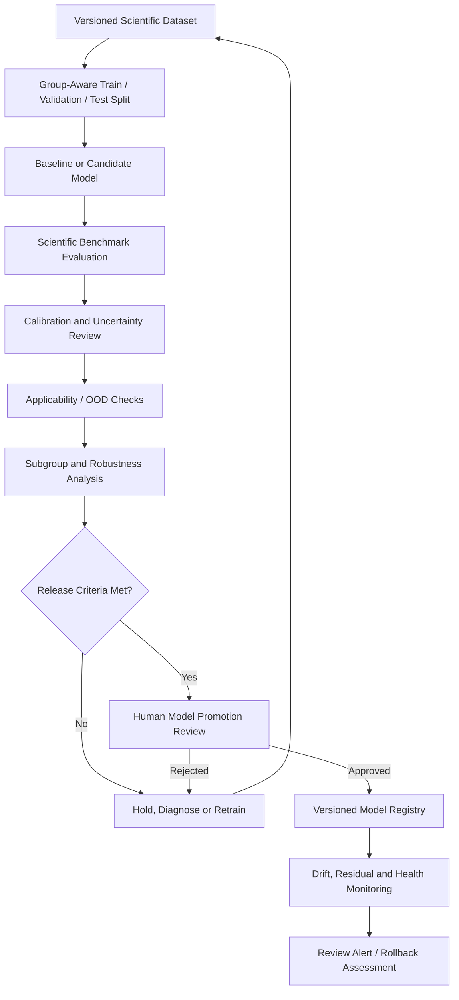
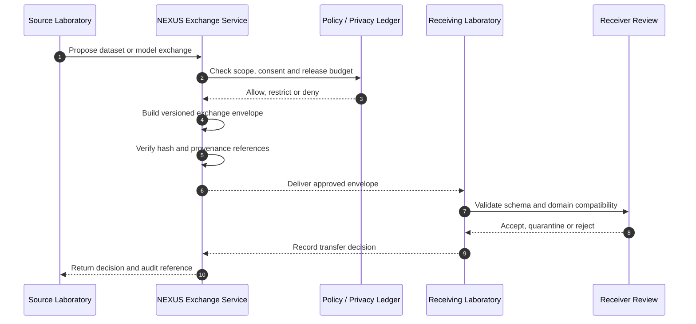

# self-driving-science-lab-ai-agents-nexus




# NEXUS Autonomous Science Network

### A governed, multi-agent operating layer for scientific discovery across self-driving laboratories


NEXUS is a research-software foundation for connecting specialized scientific laboratories, AI agents, scientific models, digital twins, experimental workflows, and evidence provenance through one coordinated platform.

The network is organized around eight domain-specific laboratories (SDL0–SDL7). Each laboratory keeps its own scientific methods and constraints while sharing common infrastructure for research objectives, agent orchestration, sample and experiment identity, data quality, model governance, human approval, and reproducibility.

> **Prototype and safety notice:** The current application is a governed software prototype. Demo records and digital-twin outputs are synthetic. AI-generated content is not scientific evidence until reviewed and validated. Physical instrument and robotic execution is deliberately disabled; the available instrument and robotics interfaces are contracts and simulation boundaries, not authorization to operate hardware.

> **Repository sync note:** The linked GitHub `main` branch currently exposes an initial README and the `8.png` reference image. The backend/frontend source tree, API route inventory, and module map documented below describe the companion NEXUS implementation workspace available during README preparation; those source directories were not verifiable at the corresponding paths on the remote branch. Commit the matching application source tree to this repository before treating the implementation map as a remote-branch file inventory.

---

## Table of contents

- [At a glance](#at-a-glance)
- [Why NEXUS](#why-nexus)
- [The eight-laboratory network](#the-eight-laboratory-network)
- [Scientific principles](#scientific-principles)
- [System architecture](#system-architecture)
- [AI and multi-agent intelligence](#ai-and-multi-agent-intelligence)
- [Scientific discovery workflow](#scientific-discovery-workflow)
- [Scientific data fabric and provenance](#scientific-data-fabric-and-provenance)
- [Experiment governance and lifecycle](#experiment-governance-and-lifecycle)
- [Scientific models and model governance](#scientific-models-and-model-governance)
- [Cross-laboratory exchange](#cross-laboratory-exchange)
- [Application modules](#application-modules)
- [Backend API map](#backend-api-map)
- [Repository structure](#repository-structure)
- [Technology stack](#technology-stack)
- [Quick start](#quick-start)
- [Configuration](#configuration)
- [API examples](#api-examples)
- [Testing and quality checks](#testing-and-quality-checks)
- [Docker deployment](#docker-deployment)
- [Security, safety, and responsible operation](#security-safety-and-responsible-operation)
- [Current implementation boundaries](#current-implementation-boundaries)
- [Development roadmap](#development-roadmap)
- [Contributing](#contributing)
- [License](#license)

---

## At a glance

| Area | NEXUS foundation |
|---|---|
| Scientific network | Eight specialized laboratories, SDL0–SDL7 |
| Agent infrastructure | Specialist registry, capability contracts, bounded task planning, review and evaluation |
| AI runtime | Deterministic provider by default; optional OpenAI-compatible chat adapter |
| Research intelligence | Scientific source records, retrieval, evidence reconciliation, claim graphs and argument maps |
| Experiment intelligence | Objective compilation, hypothesis tracking, candidate ranking and active-learning services |
| Scientific computing | Domain calculators and methods for electrochemistry, diffraction, battery metrics, polymers, kinetics, formulations, spectra and morphology |
| Model intelligence | Dataset construction, baseline training, prediction, calibration, applicability, monitoring and promotion review |
| Advanced research | Digital-twin calibration, uncertainty propagation, sequential design, multi-fidelity modelling and value-of-information methods |
| Data governance | Samples, artifacts, data quality, lineage, audit events and experiment provenance |
| Execution governance | Experiment lifecycle, safety checks, human approval, workflow checkpoints and recovery plans |
| Frontend | Next.js / React / TypeScript workspace with dedicated scientific work areas |
| API | FastAPI application with grouped REST endpoints and interactive OpenAPI documentation |

The companion backend workspace currently exposes **300 `/api` operations** across AI intelligence, advanced research, science calculators, orchestration, provenance, model intelligence, laboratory registries, and supporting services. The exact API surface can evolve as modules are integrated.

## Why NEXUS

Scientific discovery is distributed across papers, datasets, models, instruments, samples, simulation tools, and people. A useful autonomous laboratory platform must connect those systems without confusing a model's suggestion with a real experimental observation.

NEXUS is designed around four activities:

1. **Discover** — understand the literature, organize evidence, identify research gaps, and develop testable hypotheses.
2. **Design** — evaluate candidate spaces, quantify uncertainty, optimize experimental choices, and account for cost and feasibility.
3. **Execute** — compile reviewed plans into governed computational or simulated workflows, with clear integration boundaries for laboratory equipment.
4. **Learn** — validate results, preserve provenance, evaluate models, and make trustworthy scientific knowledge reusable.

The platform is not intended to replace the scientist. It is intended to make research workflows more traceable, comparable, reproducible, and efficient.

## The eight-laboratory network

Each SDL has a primary scientific remit. Shared NEXUS infrastructure connects the labs, but domain-specific scientific rules remain local to each discipline.

| Laboratory | Name | Primary research areas |
|---|---|---|
| **SDL0** | AI & Robotics | Scientific agents, AI infrastructure, robotics simulation, instrument interfaces, computer vision, digital twins, reliability and safety engineering |
| **SDL1** | Inorganic Materials | Solid-state electrolytes, battery materials, crystal structures, defects, ionic transport, electrochemistry, semiconductors and catalysis |
| **SDL2** | Organic Chemistry | Molecular design, reaction mechanisms, quantum chemistry, reaction prediction, synthesis feasibility and analytical confirmation |
| **SDL3** | Medicinal Chemistry | Structure–activity relationships, molecular recognition, binding and selectivity evidence, assay quality, solubility and metabolic-stability research |
| **SDL4** | Polymers | Molecular architecture, crystallization, phase behavior, rheology, mechanical properties, thermal stability and degradation |
| **SDL5** | Formulations | Composition and mixture design, compatibility, stability, particle attributes and batch consistency |
| **SDL6** | Organoids & Organ-on-Chip | Biological-model provenance, organoid imaging, cellular metabolism, mechanobiology, functional characterization and replication |
| **SDL7** | Scale-up & Process Engineering | Reaction kinetics, process monitoring, mixing, heat and mass transfer, scale-up, manufacturing feasibility and process optimization |

### Network architecture



### Shared capabilities

- Persistent laboratory, sample, experiment, objective, hypothesis, and artifact identities.
- Versioned scientific data contracts and measurement semantics.
- Domain-aware agent capabilities and explicit permissions.
- Evidence review, source attribution, and contradiction tracking.
- Experiment lifecycle controls and human approval records.
- Model evaluation, applicability checks, uncertainty and monitoring.
- Digital-twin calibration and explicit simulation labels.
- Audit trails, workflow checkpoints, and provenance relationships.

## Scientific principles

NEXUS applies five levels of scientific understanding:

1. **Fundamental physics** — quantum states, forces, energy, thermodynamics and transport.
2. **Chemical mechanisms** — bonding, reactions, catalysis and molecular interactions.
3. **Structure and organization** — crystals, molecules, polymers, interfaces and cells.
4. **Observable properties** — conductivity, stability, mechanical response, spectral signatures and biological function.
5. **Real-world performance** — energy systems, advanced materials, medicines research, process performance and sustainable manufacturing.

A candidate that looks promising computationally is not automatically synthesizable. A syntactically valid molecular structure is not automatically stable. A docking score is not a measured binding affinity. A predicted conductivity is not an electrochemical measurement. NEXUS keeps these distinctions explicit in contracts and user-facing workflows.

## System architecture

The application is split into a Next.js client, a FastAPI service, domain and AI service modules, and a relational persistence layer. Optional integrations are kept behind adapters rather than being assumed to exist.



### Architectural boundaries

| Layer | Responsibility | Current foundation |
|---|---|---|
| Presentation | Navigation, dashboards, review surfaces, forms and visualizations | Next.js / React feature modules |
| API | Input validation, HTTP contracts and route composition | FastAPI routers and Pydantic schemas |
| AI runtime | Model routing, provider calls, bounded planning, retrieval and review | Deterministic provider plus optional compatible chat adapter |
| Agent layer | Task graphs, role contracts, permissions, debate and output validation | Python service modules and API routes |
| Science layer | Domain calculations, scientific feature processing and experiment design | Domain-specific service modules |
| Model layer | Datasets, predictions, calibration, applicability, monitoring and release review | Model intelligence and ModelOps services |
| Governance | Lifecycle transitions, approvals, safety checks, audit and recovery | Explicit state and policy services |
| Persistence | Scientific records and workflow metadata | SQLAlchemy; SQLite default, configurable database URL |
| External integrations | Object storage, model services, ROS 2, instruments and specialized libraries | Adapter interfaces / integration targets; validate per deployment |

## AI and multi-agent intelligence

NEXUS treats AI as a bounded service that supports scientific work. A language model can help interpret, structure, and review information, but it does not receive unrestricted authority over the laboratory.

### AI subsystems

| Subsystem | Purpose | Current implementation boundary |
|---|---|---|
| Provider interface | Standard chat-completion contract | Deterministic provider and OpenAI-compatible HTTP adapter |
| Model routing | Select a provider route based on task/domain context and budget constraints | In-process routing service |
| Scientific retrieval | Chunking, BM25, query expansion, hybrid retrieval, ranking and source-quality checks | Local retrieval and knowledge services; external corpus ingestion is deployment-specific |
| Evidence grounding | Keep claims connected to retrieved source records and limitations | Citation and grounding validators |
| Agent planning | Decompose research objectives into bounded analytical tasks | Task graph and planning services |
| Agent collaboration | Review synthesis, debate, typed messages and output checks | Bounded service workflows, not 100 continuously running autonomous processes |
| Multimodal features | Represent tabular, molecular, crystal, image, spectral and time-series inputs | Descriptor/encoder/fusion contracts and baseline services; not a universal pretrained foundation model |
| ModelOps | Ensembles, calibration, uncertainty, feature selection, subgroup monitoring and alerts | Algorithmic services and API integrations; model quality is domain- and dataset-dependent |
| AI evaluation | RAG, agent, contract, adversarial and robustness evaluations | Evaluation services and benchmark scenarios |
| Learning data | Feedback review, training-example eligibility, manifests and group-aware splits | Governance-oriented training-data pipeline foundations |
| Experimental AI v4 | Scientific retrieval, contrastive/graph learning, continual/meta-learning, prompt guards and Bayesian optimization | Research-oriented modules; not all modules are enabled in the default runtime |

### Agent orchestration model



### Agent responsibilities

Agents should be evaluated on measurable tasks, not on how convincing their natural-language output appears. Representative responsibilities include:

- Literature extraction and source quality assessment.
- Hypothesis drafting and falsifiability checks.
- Domain constraints and scientific-method selection.
- Candidate generation and property prediction.
- Uncertainty estimation and applicability screening.
- Sequential experiment selection and Pareto ranking.
- Data-quality and anomaly review.
- Protocol and resource feasibility checks.
- Scientific disagreement and contradiction reports.
- Discovery summaries with evidence references.

The specialist registry describes capabilities and permissions. It should not be interpreted as a claim that every registered agent is a separately trained model or an always-on process.

### AI provider configuration

AI is disabled by default. Deterministic mode is the offline-friendly baseline. An OpenAI-compatible adapter can be configured for chat-completion endpoints. The adapter sends messages only; it does not delegate tool execution to the provider. Server-side NEXUS services remain responsible for tools, validation, and permissions.

The runtime warns that provider output is not scientific evidence until independently validated. Deterministic provider responses are labelled synthetic.

## Scientific discovery workflow

The initial demonstration is AI-assisted inorganic solid-state electrolyte discovery in SDL1. The same workflow abstractions are intended to support other domains after their scientific methods and safety requirements are configured.

```mermaid
sequenceDiagram
    autonumber
    actor Scientist
    participant UI as NEXUS UI
    participant API as FastAPI
    participant AI as Research / Agent Services
    participant OPT as Models and Optimizer
    participant GOV as Governance
    participant TWIN as Digital Twin
    participant DATA as Data and Provenance

    Scientist->>UI: Define research objective
    UI->>API: Submit objective
    API->>AI: Compile objective and retrieve evidence
    AI-->>API: Hypotheses, claims and limitations
    API->>OPT: Evaluate candidates and uncertainty
    OPT-->>API: Ranked proposals and design rationale
    API-->>UI: Reviewable experiment proposal
    Scientist->>UI: Request approval
    UI->>GOV: Submit approval request
    GOV-->>UI: Approval state and review requirements
    Scientist->>UI: Approve simulation workflow
    UI->>GOV: Record reviewer decision
    GOV-->>API: Authorized demo workflow
    API->>TWIN: Run synthetic simulation
    TWIN-->>API: Synthetic outputs and model metadata
    API->>DATA: Validate, label and record lineage
    DATA-->>API: Quality report and provenance ID
    API-->>UI: Results, limitations and audit events
```

### First demonstrator: battery materials discovery

Research objective: identify inorganic solid-state electrolyte candidates with promising ionic transport, electrochemical stability, and practical feasibility.

A typical computational loop can include:

1. Retrieve and review relevant literature and existing candidate records.
2. Structure a hypothesis and its predicted observables.
3. Validate chemical/formula and domain constraints.
4. Evaluate available structural/property records.
5. Estimate expected outcomes and uncertainty.
6. Rank candidate computational experiments.
7. Review a digital-twin estimate.
8. Obtain the required human approval for the demonstration workflow.
9. Run a labelled synthetic simulation.
10. Validate and record the output with provenance.
11. Review the evidence and update the next research proposal.

A synthetic run demonstrates software contracts and feedback flow only. It does not demonstrate that a material was synthesized or tested.

## Scientific data fabric and provenance

NEXUS separates raw data from normalized records and scientific interpretations. A transformation should create a derived artifact and retain links to the source material.

### Six logical data layers

| Layer | Contents | Design rule |
|---|---|---|
| Raw | Instrument exports, microscopy, spectra, sensor streams, simulations and notebooks | Preserve original source artifacts; do not silently overwrite |
| Validated | Parsed records, validated units, sample identity, calibration references and quality flags | Validation status must be inspectable |
| Processed | Normalized values, extracted features, segmented images and derived signals | Record transformation method and software version |
| Scientific | Measurements, observations, experiment outcomes and interpretations | Keep evidence origin and measurement context |
| AI | Model features, training snapshots, predictions, labels and evaluation outputs | Retain dataset/model version and applicability information |
| Knowledge | Hypotheses, claims, mechanisms, conclusions and evidence relationships | Conclusions must resolve to supporting and conflicting evidence |



### Provenance chain

Every result should be traceable across the following relationships:

```mermaid
flowchart LR
    OBJ[Objective] --> HYP[Hypothesis]
    HYP --> CAND[Candidate]
    CAND --> SAMPLE[Sample]
    SAMPLE --> EXP[Experiment]
    EXP --> INST[Instrument / Computational Method]
    INST --> RAW[Raw Artifact]
    RAW --> MEAS[Measurement / Derived Result]
    MEAS --> QA[Quality Assessment]
    QA --> MODEL[Model Input or Evaluation]
    MODEL --> CONC[Scientific Conclusion]
```



Important metadata includes persistent IDs, laboratory and domain, sample/experiment references, source system, instrument, units, environmental conditions, calibration, timestamps, uncertainty, operator/reviewer, quality status, schema version, and provenance references. Domain-specific schemas should add method-specific metadata instead of relying on one generic measurement table.

### Evidence origins

NEXUS distinguishes at minimum:

- `measured_value`
- `computational_result`
- `model_prediction`
- `literature_value`
- `human_observation`
- `inferred_value`
- `synthetic_simulation`

These origins are not interchangeable. In particular, synthetic records and model predictions must not be silently promoted to measured scientific data or production training labels.

## Experiment governance and lifecycle

Every experiment proposal follows an explicit state machine. A valid API request alone does not mean an experiment is authorized to execute.



Lifecycle states and allowed transitions are enforced by backend services. Approval events, state transitions, and workflow actions are recorded for audit. A recovery plan is advisory; it does not automatically replay physical actions.

## Scientific models and model governance

The model intelligence foundation includes dataset assembly, modality-specific feature interfaces, baseline models, prediction records, calibration, ensemble methods, applicability checks, monitoring and promotion review.

### Model development and release lifecycle



### Model quality dimensions

Do not collapse model quality into one generic accuracy score. NEXUS services are structured to evaluate different dimensions:

- Predictive error and baseline comparison.
- Calibration and interval coverage.
- Predictive and epistemic uncertainty where supported.
- Applicability domain and out-of-distribution warnings.
- Subgroup performance and data coverage.
- Feature and residual drift.
- Reproducibility and dataset lineage.
- Evidence attribution and model-card completeness.
- Human review and model promotion decision.

Group-aware splits are important when multiple rows originate from the same sample, batch, donor, experiment, or material family. The split strategy should prevent related records from leaking across evaluation partitions.

### Multimodal scientific data

The AI and model-intelligence packages include interfaces and processing foundations for:

| Modality | Example representation | Example scientific use |
|---|---|---|
| Tabular | Numeric/categorical features | Composition and process records |
| Molecular | Molecular descriptors/graphs | Structure and property modelling |
| Crystal | Composition and structural descriptors | Defect and ionic transport research |
| Images | Metadata, masks and morphology features | Microscopy and sample characterization |
| Spectra | Peak and signal descriptors | Spectroscopy and diffraction workflows |
| Time series | Windowed and aligned sensor features | Process monitoring and electrochemical cycling |
| Text | Chunks, embeddings and source metadata | Literature retrieval and evidence synthesis |

The presence of an encoder or feature interface does not imply that a large pretrained model has been trained on every scientific domain. Model capability must be declared by domain, modality, target property, training dataset, version, and evaluation evidence.

## Cross-laboratory exchange

Cross-lab collaboration should transfer reusable knowledge while preserving source identity, experimental context, access policy and evidence origin.



The current code includes exchange envelopes, compatibility checks, privacy-budget ledger services, and federated aggregation logic. These are software-level foundations; they should not be described as a fully audited cryptographic secure-aggregation system or a certified differential-privacy deployment without a separate security review.

## Application modules

The frontend is organized into dedicated work areas under `frontend/src/features`.

| Workspace | Purpose |
|---|---|
| Command center | Network status, laboratory overview, agents, experiments and events |
| Lab network | SDL0–SDL7 capabilities and activity |
| Agent operations | Specialist profiles, permissions and agent task controls |
| AI Studio | AI runtime, prompts, knowledge and model intelligence controls |
| Materials discovery | Initial SDL1 candidate discovery demonstrator |
| Research | Sources, hypotheses and scientific reasoning workflows |
| Experiments | Experiment proposals, lifecycle and experiment detail |
| Governance | Approval queue, policy review and audit visibility |
| Scientific data | Datasets, measurements, quality and provenance |
| Samples | Sample registration, verification and ancestry |
| Models | Model records, evaluations and predictions |
| Orchestration | Workflow runs, checkpoints and recovery review |
| Research campaigns | Multi-stage research programmes with human stage review |
| Digital twin | Twin overview, calibration and simulation-oriented workflows |
| Science methods | Domain-specific scientific calculators and analysis utilities |
| Advanced research | Uncertainty, sequential design, transfer, drift and multi-lab methods |

## Backend API map

The API is mounted under `/api`. The route groups below describe the current route organization; consult `/docs` or `/openapi.json` for the exact request and response schemas for the running version.

| Prefix | Scope |
|---|---|
| `/api/ai/*` | AI status, prompt versions, knowledge ingestion/search, grounded answers, tools, planning, feature encoding/fusion, model operations, evaluations, memory, budget, feedback and training data |
| `/api/advanced-research/*` | Twin calibration, uncertainty, sequential design, cross-lab exchange, federated aggregation, privacy ledgers, transferability, drift, simulation models, multi-fidelity and evidence methods |
| `/api/labs/*` | Laboratory registry and domain information |
| `/api/agents/*` | Specialist agent registry and bounded runs |
| `/api/agent-runtime/*` | Agent tasks and execution history |
| `/api/agent-intelligence/*` | Task-graph compilation, debate, retry, permissions and output validation |
| `/api/objectives/*` | Objective creation, compilation and versioned revision |
| `/api/experiments/*` | Experiment creation, retrieval, lifecycle transitions and simulation path |
| `/api/governance/*` | Approval requests, reviewer decisions and approval records |
| `/api/discovery/*` | Candidate lists and next-batch proposals |
| `/api/research-intelligence/*` | Domain validation, factorial design, Pareto ranking, active learning, failure triage, protocol and reproducibility review |
| `/api/research-sources/*` | Literature/source registry and scientific claims |
| `/api/hypothesis-intelligence/*` | Hypothesis evidence and decision records |
| `/api/science/*` | Scientific domains, validation, evidence assessment and contradictions |
| `/api/science-calculators/*` | Domain-specific science calculations |
| `/api/science-foundations/*` | Scientific contracts and foundational methods |
| `/api/modalities/*` | Spectra, time series, images, molecular descriptors and crystal parsing interfaces |
| `/api/model-intelligence/*` | Dataset construction, training baseline, model registry, prediction and promotion review |
| `/api/model-evaluation/*` | Conformal calibration, applicability, ensemble, subgroup and monitoring methods |
| `/api/data/*` | Datasets, measurements and data-quality summaries |
| `/api/samples/*` | Sample registration, verification and ancestry |
| `/api/artifacts/*` | Artifact registration and parent/lineage validation |
| `/api/lineage/*` | Dataset and scientific lineage checks |
| `/api/orchestration/*` | Workflow creation, history, checkpoints and recovery plans |
| `/api/research-campaigns/*` | Research campaign state, stage progression and review |
| `/api/transfers/*` | Cross-lab transfer requests and decisions |
| `/api/telemetry-intelligence/*` | Telemetry-stream review |
| `/api/outbox/*` | Event delivery preparation, acknowledgement, metrics and lease recovery |
| `/api/scheduler/*` | Resource-aware schedule preview |
| `/api/network-intelligence/*` | Network-level science and coordination methods |
| `/api/overview`, `/api/twin`, `/api/models`, `/api/events` | Summary and registry views |

### Useful read endpoints

| Method | Endpoint | Description |
|---|---|---|
| `GET` | `/health` | API health and runtime mode |
| `GET` | `/api/overview` | Network summary |
| `GET` | `/api/labs` | Eight-lab directory |
| `GET` | `/api/agents` | Specialist agent registry |
| `GET` | `/api/experiments` | Experiment records |
| `GET` | `/api/discovery/candidates` | Candidate records |
| `GET` | `/api/data/measurements` | Measurement records |
| `GET` | `/api/ai/status` | AI configuration status |
| `GET` | `/api/models` | Model cards |
| `GET` | `/api/events` | Recent system events |

## Repository structure

```text
self-driving-science-lab-ai-agents-nexus/
├── README.md
├── 8.png                         # Project visual reference
├── backend/
│   ├── app/
│   │   ├── api/                  # FastAPI routers
│   │   ├── core/                 # Configuration, database, logging, errors
│   │   ├── models/               # SQLAlchemy entities
│   │   ├── schemas/              # Pydantic API and science contracts
│   │   └── services/
│   │       ├── advanced_research/ # Twins, uncertainty, transfer, federation
│   │       ├── agents/            # SDL-specific scientific agent services
│   │       ├── agent_intelligence/# Task graphs, dispatch, debate, permissions
│   │       ├── ai/                # Runtime, RAG, provider, evaluation and ModelOps
│   │       │   ├── evaluation/    # RAG, agent and robustness evaluation
│   │       │   ├── modelops/      # Calibration, ensemble, monitoring
│   │       │   ├── multimodal/    # Alignment, encoders and fusion
│   │       │   ├── providers/     # Deterministic and compatible chat providers
│   │       │   ├── reasoning/     # Claim graph, argument map and critic
│   │       │   ├── retrieval/     # Chunking, BM25, hybrid retrieval and reranking
│   │       │   ├── training/      # Data curation and split foundations
│   │       │   └── v4/            # Experimental AI algorithm modules
│   │       ├── domain_science/    # Battery, diffraction, electrochemistry, polymer, etc.
│   │       ├── integrations/     # Instrument and storage adapter contracts
│   │       ├── model_intelligence/# Modality features, baselines and evaluation
│   │       ├── science_governance/# Agent capacity and model release controls
│   │       └── ...               # Provenance, lifecycle, scheduler, workflows
│   ├── tests/                    # API, domain, safety and service tests
│   ├── requirements.txt
│   ├── pyproject.toml
│   └── .env.example
├── frontend/
│   ├── app/                      # Next.js app shell and global styles
│   ├── src/
│   │   ├── components/           # Shared layout, panels and status components
│   │   ├── features/              # Product workspaces
│   │   ├── lib/                   # API client and deterministic demo data
│   │   └── types/                 # TypeScript domain types
│   ├── package.json
│   └── .env.example
├── docs/                         # Agent catalogue, contracts and volume notes
├── docker-compose.yml
├── Makefile
├── .nvmrc
└── .python-version
```

## Technology stack

| Layer | Current dependency / approach |
|---|---|
| Web application | Next.js 16, React 19, TypeScript |
| UI visualization | Recharts 3, Lucide icons, CSS modules/global CSS |
| API | FastAPI, Uvicorn |
| Data validation | Pydantic 2, pydantic-settings |
| Persistence | SQLAlchemy 2; SQLite default |
| HTTP / tests | HTTPX, pytest |
| AI provider boundary | Deterministic provider and OpenAI-compatible HTTP adapter |
| Retrieval foundation | Local chunking, BM25, hybrid search and ranking services |
| Scientific optimization | In-process Bayesian/active-learning and multi-objective service foundations |
| Domain computation | Python scientific algorithms and typed domain services |
| Deployment | Dockerfiles and Docker Compose |

The repository deliberately keeps optional integrations separate from the core installation. Libraries such as PyTorch, RDKit, pymatgen, ASE, BoTorch, ROS 2 and vendor instrument SDKs are not implied to be installed merely because integration or modality modules exist. Add and validate the dependencies required by the specific deployment and science domain.

## Quick start

### Prerequisites

- Python **3.12** (see `.python-version`).
- Node.js **26** (see `.nvmrc`); the frontend package declares Node.js `>=20.9.0`.
- npm.
- Optional: Docker and Docker Compose.

### 1. Start the backend

```bash
cd backend
python -m venv .venv

# macOS / Linux
source .venv/bin/activate

# Windows PowerShell
# .venv\Scripts\Activate.ps1

python -m pip install --upgrade pip
pip install -r requirements.txt
cp .env.example .env
uvicorn app.main:app --reload --port 8000
```

The application lifespan creates the database schema and seeds the development demonstration records. The default database URL is SQLite in the backend working directory.

### 2. Start the frontend

In a second terminal:

```bash
cd frontend
npm install
cp .env.example .env.local
npm run dev
```

Open `http://localhost:3000`.

### 3. Explore the API

- Health: `http://localhost:8000/health`
- Swagger UI: `http://localhost:8000/docs`
- ReDoc: `http://localhost:8000/redoc`
- OpenAPI JSON: `http://localhost:8000/openapi.json`

If the backend is offline, portions of the frontend can render deterministic local demo data. Demo fallback data is for interface exploration and is not persisted server-side.

## Configuration

### Backend environment variables

Copy `backend/.env.example` to `backend/.env` and configure the values for the environment.

| Variable | Default | Description |
|---|---|---|
| `NEXUS_APP_NAME` | `NEXUS Autonomous Science Network` | FastAPI application title |
| `NEXUS_ENV` | `development` | Environment label |
| `NEXUS_DATABASE_URL` | `sqlite:///./nexus.db` | SQLAlchemy database URL |
| `NEXUS_CORS_ORIGINS` | `http://localhost:3000` | Comma-separated allowed origins |
| `NEXUS_DEMO_MODE` | `true` | Enables development/demo semantics |
| `NEXUS_LOG_LEVEL` | `INFO` | Application log level |
| `NEXUS_AI_ENABLED` | `false` | AI runtime feature flag |
| `NEXUS_AI_PROVIDER` | `deterministic` | Provider selection |
| `NEXUS_AI_BASE_URL` | empty | OpenAI-compatible API base URL |
| `NEXUS_AI_API_KEY` | empty | Provider API key; keep secret |
| `NEXUS_AI_MODEL` | empty | Provider model identifier |
| `NEXUS_AI_TIMEOUT_SECONDS` | `30.0` | Bounded provider timeout |
| `NEXUS_AI_MAX_OUTPUT_TOKENS` | `1200` | Output token ceiling |
| `NEXUS_AI_DAILY_BUDGET_USD` | `10.0` | Configured AI budget limit |

The current `.env.example` intentionally uses deterministic mode. Configure a compatible provider only after reviewing its data-retention, privacy, contractual, and research-data requirements. Never commit real API keys.

### Frontend environment variables

Copy `frontend/.env.example` to `frontend/.env.local`.

| Variable | Default | Description |
|---|---|---|
| `NEXT_PUBLIC_API_URL` | `http://localhost:8000` | Browser-visible API base URL |

`NEXT_PUBLIC_*` values are embedded into browser-facing code. Do not place secrets in frontend environment variables.

## API examples

### Health check

```bash
curl http://localhost:8000/health
```

Example response:

```json
{
  "status": "ok",
  "service": "nexus-api",
  "version": "0.1.0",
  "demo_mode": true
}
```

### Inspect the laboratory network

```bash
curl http://localhost:8000/api/labs
```

### Inspect the AI runtime status

```bash
curl http://localhost:8000/api/ai/status
```

### Inspect available scientific domains

```bash
curl http://localhost:8000/api/science/domains
```

### Use the OpenAPI schema for write operations

Create/approve/simulate operations are intentionally governed and have versioned input schemas. Use the interactive docs at `/docs` to inspect required request fields before calling routes such as:

- `POST /api/objectives`
- `POST /api/objectives/compile`
- `POST /api/experiments`
- `POST /api/governance/experiments/{experiment_id}/request-approval`
- `POST /api/governance/approvals/{approval_id}/decision`
- `POST /api/experiments/{experiment_id}/simulate`

A simulation request does not operate physical laboratory equipment.

## Testing and quality checks

Run the backend tests from the `backend` directory:

```bash
cd backend
pytest -q
```

Compile the Python application and tests:

```bash
python -m compileall -q app tests
```

Run frontend TypeScript checks:

```bash
cd frontend
npm run typecheck
```

The test suite covers API workflows, lifecycle rules, scientific contracts, domain calculators, data quality, provenance, model applicability, agent evaluation, digital-twin calibration, advanced uncertainty and transfer logic, and physical-execution safety boundaries. Test counts can change as the project evolves; run the commands above on the current branch for the authoritative result.

## Docker deployment

The repository includes a Docker Compose development topology:

```bash
docker compose up --build
```

Services:

- `api`: FastAPI on port `8000`.
- `web`: Next.js on port `3000`.
- `nexus-data`: named volume for the SQLite database file.

Stop the services with:

```bash
docker compose down
```

Remove the persisted development database volume only when you intend to discard local demo state:

```bash
docker compose down -v
```

For production, replace development settings, configure a managed database, establish TLS and ingress controls, use a managed secret store, add schema migrations and backups, and validate the deployment against your institution's data-governance requirements.

## Security, safety, and responsible operation

Scientific autonomy must be bounded by deterministic controls and local laboratory safety systems.

### Current safety principles

- AI agents propose and analyze; they do not grant themselves execution permission.
- Experiment lifecycle transitions are validated by backend services.
- Human approval is represented as an explicit record.
- Synthetic outputs are labelled and kept distinct from measurement evidence.
- Provider output is not treated as validated scientific truth.
- External chat providers do not receive NEXUS tool-execution authority.
- Instrument and robotics interfaces are adapter contracts; local interlocks remain outside the cloud AI control plane.
- Workflow recovery plans are advisory and must not replay physical actions automatically.
- Cross-laboratory transfers should preserve provenance, schema context, and explicit authorization decisions.
- Model promotion requires evaluation and review; an LLM explanation is not a model validation result.

### Before connecting real equipment

A hardware integration must separately implement and validate:

1. Local controller and vendor-driver integration.
2. Equipment-specific capability and command schemas.
3. Authentication and least-privilege authorization.
4. Command idempotency, expiration and acknowledgement semantics.
5. Physical interlocks and emergency-stop behaviour.
6. Local operator procedures and manual override.
7. Fault recovery and sample custody handling.
8. Hardware-in-the-loop tests in a controlled environment.
9. Audit and provenance capture.
10. Institutional safety review and qualified operator sign-off.

A digital twin is a model of a physical system, not a guarantee that the physical system will behave identically.

## Current implementation boundaries

NEXUS combines working application foundations with research-oriented modules and future integration points. The following distinctions matter:

| Capability | Current status | What is not implied |
|---|---|---|
| SDL0–SDL7 registry | Implemented application registry and domain descriptions | Eight physical laboratories are not automatically connected |
| Agent network | Specialist profiles, contracts, bounded plans and evaluation foundations | Not 100 separately trained or continuously running AI agents |
| AI provider | Deterministic default and optional compatible chat adapter | No external model is called unless explicitly configured |
| AI retrieval | Local retrieval, ranking and evidence-grounding foundations | Not a continuously synchronized scholarly corpus |
| Multimodal AI | Modality contracts, descriptors, feature interfaces and fusion foundations | Not a single pretrained model that understands every modality |
| Scientific ML | Baseline training/model evaluation services and algorithm modules | Not validated predictive performance for every material or domain |
| Bayesian/active learning | Sequential design and candidate-selection foundations | Not guaranteed optimal experimental recommendations |
| Digital twins | Simulation, calibration and validation foundations | Not a validated twin for any specific physical instrument without calibration data |
| Federated learning/privacy | Aggregation and privacy-budget accounting prototypes | Not independently audited secure aggregation or certified differential privacy |
| Instrument integration | Capability and adapter contracts | No physical device actuation enabled by this starter |
| Persistence | SQLAlchemy and SQLite default | Production database operations, migrations, backup and HA still require deployment work |

## Development roadmap

### Stage 1 — Reliable scientific foundation

- Finalize versioned scientific data contracts.
- Establish persistent sample and artifact identity.
- Expand domain-specific quality and validation rules.
- Improve provenance reconstruction and audit exports.
- Maintain deterministic, reproducible service tests.

### Stage 2 — AI and model intelligence

- Connect approved external model providers using governed data-routing policies.
- Expand retrieval evaluation and citation verification.
- Benchmark agent tasks on domain-specific gold datasets.
- Train and validate modality-specific baseline models.
- Add calibration, applicability and subgroup acceptance thresholds.
- Operationalize dataset/model versioning and promotion.

### Stage 3 — Closed-loop computational discovery

- Connect the objective compiler to a durable workflow graph.
- Run multi-fidelity simulations and sequential design.
- Compare predicted outcomes with validated evidence.
- Evaluate value-of-information and stopping policies.
- Track model drift and uncertainty as experiments accumulate.

### Stage 4 — Multi-lab interoperability

- Formalize exchange envelopes and schema mappings.
- Add authenticated lab-to-lab transfer endpoints.
- Independently review privacy/federated mechanisms.
- Test domain shift and transferability before model reuse.
- Establish common benchmark and reproducibility protocols.

### Stage 5 — Controlled physical integration

- Select one instrument and one well-bounded workflow.
- Implement a local edge gateway and hardware-specific adapter.
- Validate safety interlocks and failure recovery offline.
- Conduct hardware-in-the-loop testing with qualified operators.
- Enable any physical action only through explicit local authorization and institutional approval.

## Contributing

Contributions should improve scientific correctness, reproducibility, observability, accessibility, or operational safety.

Suggested workflow:

1. Open an issue describing the scientific or engineering problem.
2. State the laboratory domain and affected data contracts.
3. Add or update tests for scientific assumptions and failure cases.
4. Keep synthetic data visibly labelled.
5. Preserve source artifacts and provenance relationships.
6. Avoid adding physical execution paths without a separate safety review.
7. Update API and architecture documentation when contracts change.

### Contribution checklist

- [ ] New scientific calculations document equations, units, assumptions and domain limits.
- [ ] Predictions include uncertainty or explain why it is unavailable.
- [ ] Model evaluations use leakage-resistant data splits where relevant.
- [ ] New API routes validate inputs and return typed outputs.
- [ ] New workflows include failure, retry and recovery tests.
- [ ] New records preserve evidence origin and provenance.
- [ ] Synthetic and measured data remain distinguishable.
- [ ] Safety-sensitive changes include negative tests proving unauthorized paths remain blocked.

## License

No license declaration was present in the inspected project files. Add a `LICENSE` file before redistributing the project or accepting third-party contributions. Until then, all rights remain with the respective copyright holder(s).

---

**NEXUS — Discover. Design. Execute. Learn.**  
A connected intelligence and automation foundation for reproducible scientific discovery.
